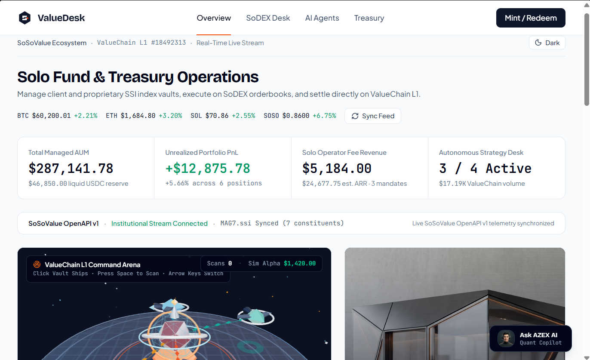
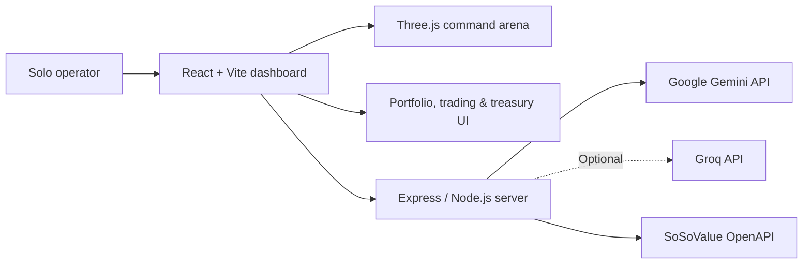

<div align="center">

# ValueDesk

### The one-person on-chain finance operating system

**An AI-assisted command center for treasury operations, SSI portfolio management, market intelligence, and execution workflows across the SoSoValue ecosystem.**


**[Launch in Google AI Studio](https://ai.studio/apps/90082d73-ecbd-4507-836a-67540b4e2fe3)** · **[Quick start](#quick-start)** · **[Features](#features)** · **[Demo walkthrough](#demo-walkthrough)**

</div>



> **Demo and data transparency:** This screenshot is a project preview. Displayed balances, prices, PnL, network status, strategy results, and order/mint flows must not be assumed to represent verified live market data, executed transactions, or real assets. Confirm each integration and transaction in the running application before describing it as live.

## Why ValueDesk?

Managing an on-chain finance operation traditionally means juggling market feeds, exchange interfaces, strategy tools, portfolio spreadsheets, and treasury records. **ValueDesk brings these operator workflows together in one dashboard**—built around a solo-operator model and designed to show where AI assistance can reduce the work between observing a market, assessing risk, and taking action.

The central idea is simple: **one operator, one workspace, multiple financial workflows.**

## Features

| Workspace | What you can explore |
| --- | --- |
| **Overview** | Managed AUM, unrealized PnL, liquid reserves, fee revenue, strategy status, and market snapshots. |
| **SoSoValue intelligence** | SoSoValue OpenAPI v1 telemetry and an interface for tracking SSI-related market information, including MAG7.ssi. |
| **ValueChain Command Arena** | An interactive 3D visualization with vault ships, a scan interaction, and camera/navigation controls. |
| **Mint / Redeem** | A workflow to explore SSI minting/redemption, fee calculation, and receipt updates. |
| **SoDEX Desk** | An orderbook-inspired trading workspace for inspecting depth and placing orders through the app's configured mode or integration. |
| **AI Agents** | Agent-cycle controls and AI-assisted strategy proposal workflows. |
| **Ask AZEX AI** | A conversational copilot for questions about markets, risk, and available operator actions. |
| **Treasury** | Treasury oversight, market stress-test scenarios, and client-mandate workflows. |

**Important:** These are features and workflows described in the project materials and shown in the interface, not independent verification of production-ready integrations. Whether an action is simulated or submits a real transaction depends on the underlying implementation and configuration.

## Built with

- **Frontend:** React 19, TypeScript, Vite, Tailwind CSS v4
- **Visualization & interaction:** Three.js, Motion, Lucide icons
- **Backend:** Express, Node.js, `tsx`, `dotenv`
- **AI integration:** Google GenAI (`@google/genai`) with an optional Groq configuration
- **Market-data integration:** SoSoValue OpenAPI, when a valid key and supported backend route are configured

### Intended application flow



*This is a high-level architecture based on the supplied project description; inspect `server.ts` and the frontend source to verify the exact integration paths.*

## Quick start

### 1. Requirements

Install [Node.js](https://nodejs.org/) (a release compatible with Vite 8, such as **20.19+ or 22.12+**) and npm. [Git](https://git-scm.com/) and [VS Code](https://code.visualstudio.com/) are recommended.

Check your tools:

```bash
node -v
npm -v
git --version
```

### 2. Install dependencies

Open the extracted project folder—the one containing `package.json`—in VS Code, then run:

```bash
npm install
```

**If npm reports `ERESOLVE` because Vite 8 requires esbuild `^0.27.0 || ^0.28.0` while the project pins `^0.25.0`:**

```bash
npm pkg set "devDependencies.esbuild=^0.28.0"
npm install
```

Prefer fixing the version mismatch over using `--force` or `--legacy-peer-deps`.

### 3. Configure environment variables

If your export contains `.env.example`, copy it into a local environment file:

**Windows PowerShell**

```powershell
Copy-Item .env.example .env
```

**macOS / Linux**

```bash
cp .env.example .env
```

Set the values in your local file:

```dotenv
GEMINI_API_KEY="YOUR_GEMINI_API_KEY"
SOSOVALUE_API_KEY="YOUR_SOSOVALUE_API_KEY"
GROQ_API_KEY=""
APP_URL="http://localhost:3000"
PORT=3000
```

| Variable | Purpose | Where to obtain it |
| --- | --- | --- |
| `GEMINI_API_KEY` | AI chat and strategist features | [Google AI Studio](https://aistudio.google.com/) |
| `SOSOVALUE_API_KEY` | SoSoValue-backed data features, where implemented | [SoSoValue OpenAPI](https://openapi.sosovalue.com/) |
| `GROQ_API_KEY` | Optional alternative AI provider, if supported by the server | [Groq Console](https://console.groq.com/) |
| `APP_URL` | Local application URL | Usually `http://localhost:3000` |
| `PORT` | Server port | Usually `3000` |

**`.env` vs `.env.local`:** The AI Studio starter instructions mention `.env.local`, while the full-stack setup supplied for this project uses `.env`. Use the filename actually loaded by your application; check `server.ts` and the Vite configuration. Do not assume that renaming a file alone makes its values available to the backend.

### 4. Run locally

```bash
npm run dev
```

Open **http://localhost:3000** (or the URL printed by the terminal).

### 5. Validate before submitting

Check the available scripts first:

```bash
npm run
```

If the relevant files and scripts exist, run:

```bash
npx tsx --test src/domain/financeEngine.test.ts
npm run lint
npm run build
```

To test production mode **on Windows PowerShell**, if the project defines a `start` script:

```powershell
$env:NODE_ENV = "production"
npm start
```

## Demo walkthrough

A focused **90–120 second** product walkthrough can demonstrate the intended end-to-end operator experience:

1. **Overview:** Introduce the AUM, PnL, reserves, operator fee revenue, asset ticker, and SoSoValue status strip.
2. **Command Arena:** Interact with the 3D vault ships, press **Space** to scan, and demonstrate available camera controls.
3. **Mint / Redeem:** Show an illustrative **5,000 USDC** SSI flow and explain the fee and receipt updates. State clearly whether it is simulated or connected to real settlement.
4. **SoDEX Desk:** Inspect the depth chart and demonstrate an order workflow. Label simulated orders accordingly.
5. **AI Agents + Ask AZEX AI:** Generate a strategy proposal, inspect risk reasoning, and show any confirmation step before a proposed action.
6. **Treasury:** Run a stress scenario and show a client-mandate workflow.

For a strong submission, show **what the interface does**, **what is connected to live services**, and **what remains a prototype**. Do not describe a UI confirmation as blockchain finality unless a verifiable transaction exists.

## Security and responsible operation

- Keep all API credentials on the server; never hardcode private keys in React components or public `VITE_` variables.
- Add `.env`, `.env.local`, `node_modules/`, `dist/`, and `.data/` to `.gitignore`, then verify what Git will commit.
- Treat generated AI strategies as recommendations requiring human review, not guaranteed investment outcomes.
- Require explicit operator confirmation and appropriate wallet authorization for real transactions.
- Verify live data freshness, API errors, order status, and on-chain receipts before presenting them as successful operations.
- This project is a prototype/educational demonstration, not a substitute for regulated financial, custody, or security infrastructure.

## Publish to GitHub

After creating an empty repository on GitHub:

```bash
git init
git add .
git status
# Confirm .env and .env.local are NOT staged.
git commit -m "Add ValueDesk on-chain finance OS"
git branch -M main
git remote add origin https://github.com/YOUR_USERNAME/YOUR_REPOSITORY.git
git push -u origin main
```

Upload **both this `README.md` and `docs/valuedesk-dashboard.png`** to preserve the screenshot at the top of the page. If a remote already exists, update it rather than adding `origin` twice.

## Hackathon submission

**Project:** ValueDesk — One-Person On-Chain Finance Business  
**Team:** AZEX  
**Builder:** Ashish Kumar  
**Ecosystem focus:** SoSoValue · SoDEX · ValueChain · SSI · AI-assisted finance operations  
**Project preview:** [Google AI Studio](https://ai.studio/apps/90082d73-ecbd-4507-836a-67540b4e2fe3)

### The pitch

> **ValueDesk turns fragmented on-chain fund operations into a single AI-assisted command center—giving a solo operator a unified view of markets, treasury, portfolio risk, and execution workflows.**

---

<div align="center">

**Built by Team AZEX · ValueDesk**

*One operator. One command center. A more accessible on-chain finance workflow.*

</div>
